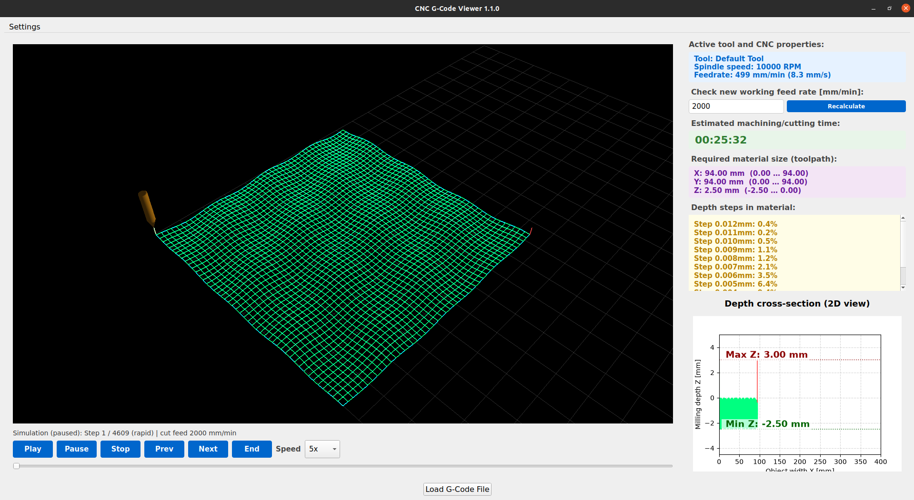
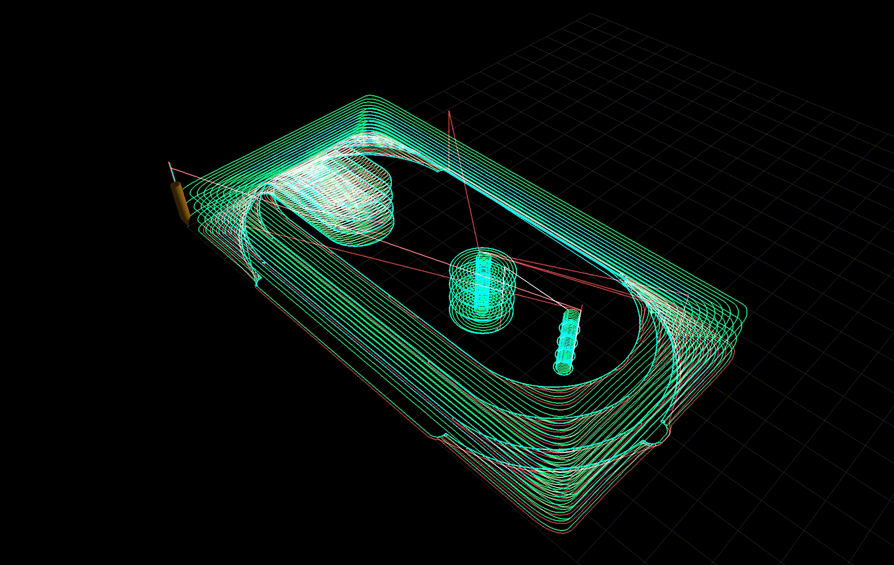

<p align="center">
  <a href="LICENSE"></a>
  <a href=".github/workflows/ci.yml"></a>
  
  
</p>

# CNC Viewer and Simulator


## CNC Viewer and Simulator screenshot example opened G-CODE (file from included examples/wave.gcode)

<p align="center">
  
</p>

## CNC Viewer and Simulator MP4 recording example

<p align="center">
  
</p>

**Validate FreeCAD CAM G-code before you waste a blank.**

Built for hobby CNC mills and FreeCAD Path/CAM users who post-process to `.nc` / `.gcode` and want a fast, visual second opinion - on the toolpath, clearances, depth steps, stock size, and feeds - **before** the machine starts cutting.

Export from FreeCAD (or another CAM), open the file here, scrub the path like a machine sim, fix surprises early, then send the job to Candle / GRBL / your controller with more confidence.

## Why FreeCAD + CNC hobbyists care

FreeCAD CAM is powerful, but the post-processed file is what the mill actually runs. Common gotchas this app helps catch:

- Adaptive / Hybrid jobs with **`F0`** (unset HorizFeed/VertFeed) - soft warnings instead of a silent bad estimate
- **Rapids and retracts above stock** (red) vs real cuts (green) - including lines with `N…` block numbers
- Tool starting or dwelling in a weird place vs a safe corner / clearance approach
- Unexpected **Z step-downs** or depth that is deeper than your stock
- “How big a blank do I need?” - **required material X / Y / Z** from the cutting envelope
- “How long will this take if I run 2000 mm/min?” - **recalculate time** with a trial feed

Green = cutting move (`G1`/`G2`/`G3`). Red = rapid / traverse (`G0`).

## Features

| Feature | What you get |
|--------|----------------|
| **3D toolpath viewer** | Interactive OpenGL scene of the full path on a configurable machine bed |
| **Cut vs rapid coloring** | Candle-style green cuts and red rapids, including `N`-prefixed FreeCAD/CAMotics lines |
| **Toolpath simulation** | Play / Pause / Stop / Prev / Next / End, speed multiplier, timeline scrubber |
| **MP4 recording** | **Recording** starts Play and writes `cnc_simulation_*.mp4` in the working directory (3D view + mouse orbit + path colors); **Stop** ends the file |
| **Simulation trail** | Pending path greys out as the virtual tool advances; restore full colors on Stop |
| **Animated endmill** | Tool mesh follows the path so you can see pose at every segment |
| **Safe idle pose** | After Stop, tool sits at the first approach / clearance pose - not buried at mid-stock `X0 Y0 Z0` |
| **2D depth cross-section** | X–Z plot with Min Z / Max Z markers for a quick depth sanity check |
| **Depth steps in material** | Scrollable list of Z step-downs and their share of the job |
| **Required stock size** | Estimated material **X × Y × Z** from the cutting envelope (not inflated by clearances) |
| **Machining time estimate** | Cut + rapid time; **Recalculate** with a what-if feedrate (mm/min) |
| **Tool / spindle / feed panel** | Reads FreeCAD-style comments and `S` / `F` words when present |
| **F0 / invalid feed handling** | Soft warnings for zero feed (common Adaptive export); default or manual feed for estimates |
| **Arc support** | `G2` / `G3` tessellated for display and simulation |
| **Layer split by Z** | Path grouped when Z levels change |
| **Machine envelope** | Configure bed width / depth / Z for your mill |
| **CNC safe start rewrite** | Shifts WCS to **left-near corner (0,0)**; idle on **stock top**, then **raise**, rapid above material to first process XY, then cut; keeps `file.bak` once |
| **Formats** | `.nc`, `.gcode`, `.ngc` |

## Typical FreeCAD workflow

1. Finish the job in FreeCAD Path/CAM and post-process to `.nc`
2. Open the file in CNC Viewer and Simulator (or pass the path on the CLI)
3. In 3D: check overall shape, **red** clearances above stock, and that the first move is a safe approach
4. Optionally click **Set CNC start: left corner + max cut Z** to rewrite the lead-in (creates `*.bak` once)
5. In the side panel: confirm **stock size**, **depth steps**, tool/spindle/feed, and estimated time
6. Run **Play** (or scrub) to walk the path; pause on anything suspicious
7. If FreeCAD left `F0`, set a real feed and hit **Recalculate** - or fix feeds in FreeCAD and re-export
8. Only then send the file to the CNC controller

## Quick start

### Requirements

- Python **3.9+**
- Linux, Windows, or macOS with a working OpenGL stack

### Install

```bash
git clone https://github.com/bieli/cnc-viewer-and-simulator.git
cd cnc-viewer-and-simulator
python -m venv .venv
source .venv/bin/activate   # Windows: .venv\Scripts\activate
pip install -r requirements.txt
pip install -e .
```

### Run

```bash
gcode-viewer
# or open a file directly:
gcode-viewer /path/to/job.nc
# or:
python -m gcode_viewer /path/to/job.nc
```

## Development

```bash
pip install -r requirements-dev.txt
pip install -e .
pytest
mypy src/gcode_viewer
```

GitHub Actions runs **pytest** and **mypy** on every push/PR.

## Project layout

```
src/gcode_viewer/
  gcode/      # parsing, machining analysis, validation (unit-tested)
  config/     # settings + file I/O
  gui/        # PyQt5 UI, 3D viewer, simulation controls
  utils/      # geometry, arcs, time/feed, stock size, simulation engine
  resources/  # icons + default machine settings
tests/        # pytest suite + FreeCAD-style fixtures
```

## Open source notes

- License: **MIT** (see [LICENSE](LICENSE))
- Settings store machine bed dimensions locally (no accounts, no telemetry)
- Do not commit personal `.nc` jobs, API tokens, or local absolute paths

## Credits

Originally created by [Johannes Hagspiel](https://github.com/johanneshagspiel).
Substantially extended for FreeCAD CAM validation and toolpath simulation by [Marcin Bielak](https://github.com/bieli).

Maintained as an open-source tool for the CNC / FreeCAD community.
