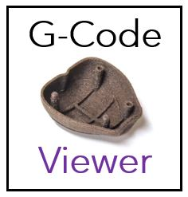

<p align="center">
  
</p>

<p align="center">
  <a href="LICENSE"></a>
  <a href=".github/workflows/ci.yml"></a>
  
</p>

# CNC G-Code Viewer

**Check your CAM toolpaths before you cut.**

CNC G-Code Viewer is a desktop app for hobby CNC millers, FreeCAD Path/CAM users, and anyone who exports `.nc` / `.gcode` files and wants a fast visual sanity check before sending them to the machine.

Open a file from FreeCAD, Fusion, Candle-compatible post-processors, or other CAM tools. Inspect the 3D toolpath, review depth steps, estimate cutting time, and catch surprises like wrong Z depths or unexpected rapids — without burning a blank.

## Why use it?

If you work with FreeCAD CAM (Path workbench) or similar tools, export is only half the job. Before you clamp stock and press Cycle Start, this viewer helps you:

- **See the toolpath in 3D** — rotate around the bed, check that travels and cuts look right
- **Inspect depth in 2D (X–Z)** — confirm min/max Z and step-down structure in the material
- **Read tool metadata** — spindle and feed hints from comments/codes typical in FreeCAD exports
- **Estimate machining time** — and recalculate what-if feed rates in mm/min
- **Validate workspace size** — set your machine bed width, depth, and Z travel

Green segments are cutting moves; red segments are rapid/traverse moves.

## Features

| Feature | What you get |
|--------|----------------|
| 3D viewer | Interactive OpenGL view of the full toolpath |
| 2D depth section | Fast X–Z plot with Min Z / Max Z markers |
| Layer split | Paths grouped by Z level changes |
| Arc support | G2/G3 arcs tessellated for display |
| Feed override | Recalculate estimated time for a trial feedrate |
| Machine setup | Configurable bed / work envelope |

## Quick start

### Requirements

- Python **3.9+**
- Linux, Windows, or macOS with a working OpenGL stack

### Install

```bash
git clone https://github.com/johanneshagspiel/gcode-viewer.git
cd gcode-viewer
python -m venv .venv
source .venv/bin/activate   # Windows: .venv\Scripts\activate
pip install -r requirements.txt
pip install -e .
```

### Run

```bash
gcode-viewer
# or open a file directly:
gcode-viewer /path/to/job.nc
# or:
python -m gcode_viewer /path/to/job.nc
```

Supported extensions: `.nc`, `.gcode`, `.ngc`.

### Typical FreeCAD workflow

1. Finish your Path/CAM job in FreeCAD and post-process to `.nc`
2. Open the file in CNC G-Code Viewer
3. Check 3D shape, clearance moves, and Z step-downs
4. Adjust feed in the side panel if you want a time estimate for another feedrate
5. Only then send the file to your CNC controller

## Development

```bash
pip install -r requirements-dev.txt
pip install -e .
pytest
mypy src/gcode_viewer
```

GitHub Actions runs **pytest** and **mypy** on every push/PR.

## Project layout

```
src/gcode_viewer/
  gcode/      # parsing, geometry, machining analysis (unit-tested)
  config/     # settings + file I/O
  gui/        # PyQt5 UI
  resources/  # icons + default machine settings
tests/        # pytest suite + sample FreeCAD-style fixture
```

## Open source notes

- License: **MIT** (see [LICENSE](LICENSE))
- Default settings store only machine bed dimensions (no accounts, no telemetry)
- Do not commit personal `.nc` jobs, API tokens, or local absolute paths

## Credits

Originally created by [Johannes Hagspiel](https://github.com/johanneshagspiel). Maintained as an open-source tool for the CNC / FreeCAD community.
